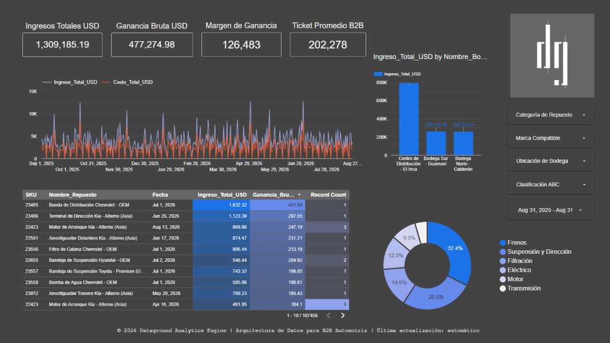

# ⚙️ DataGround Analytics Engine: B2B/B2C Auto Parts Retail
**Enterprise Data Architecture & Supply Chain Intelligence**

## Visión General del Proyecto
Este proyecto es una simulación de grado corporativo (End-to-End) diseñada para importadores y distribuidores B2B/B2C del sector de repuestos automotrices. Transforma datos transaccionales crudos en inteligencia prescriptiva de cadena de suministro (Supply Chain)

El sistema detecta patrones de compra cruzada (Market Basket) para prevenir quiebras de stock y modela la demanda intermitente usando algoritmos avanzados para optimizar el capital inmovilizado en bodegas.

## 🎯 Problema de Negocio
Los grandes distribuidores B2B de repuestos automotrices enfrentan dos fugas masivas de capital:
1. **Capital Inmovilizado:** Millones de dolares atrapados en sobrestock por malas políticas de reabastecimiento.
2. **Efecto Dominó (Lost Sales):** Pérdida de ventas corporativas masivas porque falta un sólo componente (ej. un empaque dentro de un gran pedido de reparación (Kit).
Este proyecto resuelve ambos problemas mediante Inteligencia Artificial y simulaciones de Cadena de Suministro (Supply Chain).

---
## 📁 Dataset & Data Quality

| Atributo | Detalle |
|----------|---------|
| **Fuente Base** | Dataset transactional retail (Kaggle), transformado matemáticamente a B2B Automotriz. |
| **Volumen** | +450,000 registros transaccionales (3 años de historia) + Streaming en Vivo. |
| **Variables Clave** | SKU, Transaccion_ID, Categoría, Costos (FOB/Nacionalizado), PVP Facturado. |
| **Data Governance** | Limpieza de outliers, eliminación de devoluciones nulas, y re-mapeo semántico (Pareto 80/20). |

## 🏗️ Arquitectura de Datos (Data Stack)
* **Data Lake / Storage:** Google Drive (Cloud Storage)
* **ETL & Data Wrangling:** Python (Pandas, Numpy) / Google Colab
* **Data Warehouse:** Google BigQuery (Esquema de Estrella / Star Schema)
* **Capa Semántica y BI:** Looker Studio (SQL Views)
* **Machine Learning (Fase 3):** Algoritmo FP-Growth (Optimización de memoria para matrices esparsas corporativas) para extracción de Reglas de Asociación B2B, con ingesta automatizada de de vuelta hacia BigQuery.

## 🧠 Modelos Matemáticos Implementados
1. **Weighted Hashing Semántico:** Transformación probabilística de datos genéricos a categorías automotrices respetando la ley de Pareto del mercado (35% Frenos, 25% Suspensión, etc.).
2. **Modelo de Croston:** Cálculo avanzado de demanda intermitente (ADI) para fijar Puntos de Reorden (ROP) y Stocks de Seguridad (SS) realistas en entornos B2B.
3. **Cross-Selling Risk Logic:** Motores SQL auto-gestionados para detectar "Efecto Dominó" (pérdida de ingresos por falta de componentes en un kit de reparación).
4. **Digital Twin (Simulación de Eventos Discretos):** Motor en Python que viaja en el tiempo para recrear el Kardex histórico, descontando ventas diarias y simulando tiempos de tránsito (Lead Time marítimo) para calcular con exactitud el GMROI y el capital inmovilizado real mes a mes.
5. **FP-Growth (Market Basket Analysis Avanzado):** Superando las limitaciones computacionales de Apriori ($0(2^n)$), este modelo procesa matrices binarias masivas para descubrir reglas ocultas de compra cruzada B2B, entregando predicciones de Up-Selling basadas en métricas de Confianza y Lift.

## 🗂️ Estructura del Data Lake
* `/01_raw`: Datos transaccionales crudos y desnormalizados.
* `/02_processesd`: Capa Silver. Limpieza B2B, vectorización temporal y preservación de "Cestas de Compra".
* `03_gold_star_schema`: Capa Gold. Modelo de Estrella inyectado en BigQuery (`Dim_Bodega`, `Dim_Producto`, `Fact_Ventas`).

## Emulación de Streaming (Live POS)
Para demostrar la capacidad de reacción de los tableros, el proyecto incluye un emulador de punto de venta (POS) en Python. Este script funciona bajo la capa gratuita de GCP usando **Micro-Batching** (LoadJobConfig con WRITE_APPEND) para inyectar transacciones en tiempo real a BigQuery. Cuenta con compuertas lógicas que respetan el horario comercial (8 AM - 6 PM) y reglas de descuento automático por volumen. 

## 📊 Tableros de Control (Looker Studio)

🔗 **[Ver Tablero Interactivo en Vivo -> Looker Studio](https://datastudio.google.com/s/grzLsum0LrA)**

 

Este cuadro de mando integral está estructurado en **4 páginas** cohesivas diseñadas para responder a diferentes perfiles gerenciales:

| Página | Audiencia | Propósito y Visualizaciones Clave |
|--------|-----------|-----------------------------------|
| **1. C_Suite & Finanzas** | CEO / CFO | Resumen ejecutivo del flujo de caja. Muestra ingresos YTD/TTM, simulación de márgenes B2B dinámicos, Volumen por Ticket (UPT) y Ticket Promedio (AOV). |
| **2. Supply Chain y Riesgo** | Gerente de Compras | Análisis histórico de quiebres de stock. Tablas de "Kits Paralizados" (Efecto Dominó) evaluando el impacto en dólares de las canastas incompletas |
| **3. Motor de Recomendación IA** | Director Comercial | Herramienta táctica de Up-Selling (Next Best Offer). Sugiere repuestos complementarios en vivo filtrados por Fuerza de Conexión (Lift). |
| **4. Live Benchmarks (Torre de Control)** | CDO / OpEx | Fotografía en tiempo real (Snapshot) del estado del inventario. Velocímetros de Margen actual, GMROI (Retorno de Inversión) y Días de Cobertura de Stock para prevenir quiebres de la cadena asiática. |

---

## Key Business Insights (Hallazgos Estratégicos)

Este proyecto fue auditado bajo la óptica de tres pilares gerenciales (Finanzas, Logística y Ventas), arrojando los siguientes diagnósticos accionables a partir de los datos B2B:

* **El Costo Oculto de la "Seguridad" Logística (Visión CFO):** La Torre de Control reveló una Cobertura de Inventario global de de ~149 días y 8.1 meses. Aunque en un entorno B2B asiático un *Lead Time* de 60 días justifica un *buffer*, operar al doble de la necesidad inmoviliza más de $300,00 USD en flujo de caja. Al cruzar esto con la clasificación ABC, se detectó que ele exceso de capital no está en los repuestos estrella, sino en una larga cola de productos Clase C que requieren liquidación inmediata para sanear el GMROI.
* **Cuantificación del "Efecto Dominó" B2B (Visión Supply Chain):** El análisis histórico demostró que el quiebre de stock en piezas económicas (ej. empaques o pernos) bloquea la venta de componentes principales de alto margen (Kits de Motor). El uso del modelo de demanda **Croston SBA y Bootstrapping de Monte Carlo** permitió recalibrar el Stock de Seguridad aislando el riesgo real al 95% de nivel de servicio, previniendo fugas masivas por "Kits Paralizados".
* **Up-Selling Híbrido IA + ABC (Visión CCO):** El Market Basket Analysis (FP-Growth) expuso el comportamiento real del comprador mayorista: compras combinadas para flotas multimarca (Ej. *Embragues Nissan* arrastran *Pastillas Chevrolet*). El valor táctico radicó en inyectar SQL a estas reglas para priorizarlas financieramente. Ahora, si un cliente pide un *Top Seller* (Clase A), el motor recomienda un producto de Clase C con alta fuerza de conexión (Lift), usando el producto ancla para liquidar estratégicamente el stock inmovilizado.

## 💡 Habilidades Demostradas (Skills)
`Python` `Data Engineering` `Google BigQuery` `Star Schema Data Modeling` `Looker Studio` `Machine Learning (FP-Growth)` `Market Basket Analysis` `Supply Chain Analytics (Croston)` `Financial KPIs (GMROI)` `SQL Avanzado` `Business Storytelling`

---
*Desarrollado por Juan Fernando Mosquera A. para Dataground | Construyendo arquitecturas que deciden.*
